

  

<h1 align="left">MSL</h1>

  <b>Mac Subsystem for Linux</b> 
  Real Linux on your Mac. A shell in about a second, your files on both sides, 
  and Linux apps that open as Mac windows with Dock tiles of their own.

  
  
  
  
  

  <a href="#getting-started">Getting started</a> &nbsp;·&nbsp;
  <a href="#msl-files">MSL Files</a> &nbsp;·&nbsp;
  <a href="#mslgd">mslgd</a> &nbsp;·&nbsp;
  <a href="https://milkmanabi.github.io/MSL-Wiki/">The guide</a> &nbsp;·&nbsp;
  <a href="#the-msl-family">The MSL family</a>

 

MSL runs real Linux distributions on your Mac — an actual kernel, an actual userland, on Apple's own Virtualization framework. Nothing's emulated, and there's no VM window to babysit. Type `msl` and you're in. Your home folder's already there. Linux apps show up in the Dock, in Spotlight, in ⌘-Tab, like they always lived there.

It's been over a year getting here, and most of that time was spent on problems I didn't know existed until I hit them. It's free, open source, and still held together by a fair amount of stubbornness. No like genuinely, around 4 months in planning every single subsystem, two weeks figuring out the linux guest side implementation details, a month learning about the VM framework Apple provides and most of the remaining time on testing. YES, the project has the classic AI signature mark of thousands of tests - I did manually test, for more than 100 over hours easily, I just absolutely had to automate some of the testing with scripting to even make this project semi-viable. Even now, a lot of the QC for this proj comes from me, since... I made it primarily because I wanted it.

  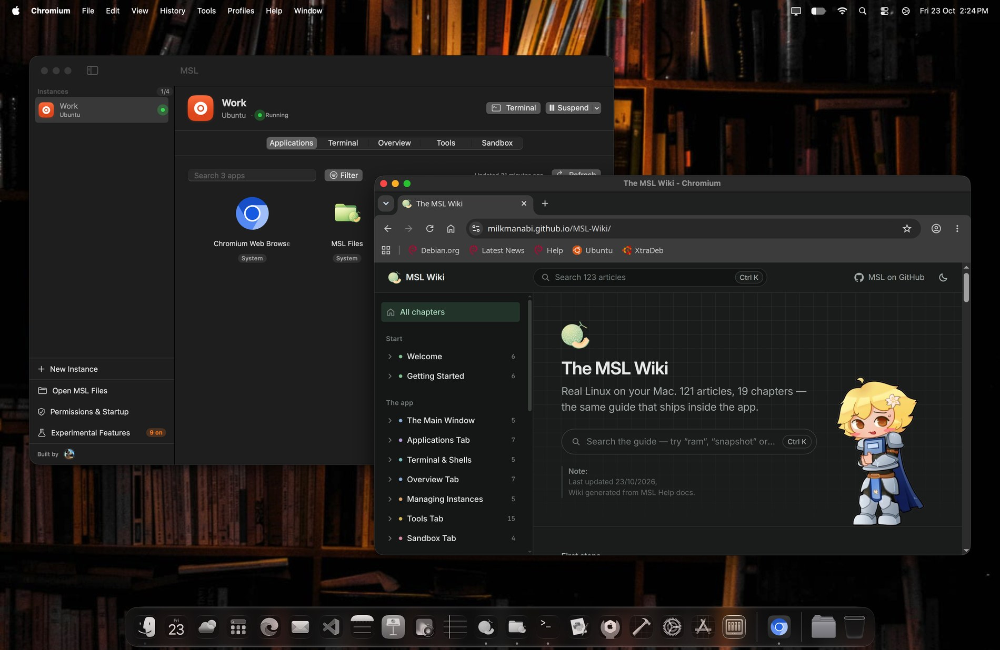

  <i>That's Chromium — the Linux one, inside Ubuntu — with its menus in the Mac menu bar and its own Dock tile.</i>

<b>More of MSL</b> &nbsp;— the app, the terminal, the file browser, the switches <i>(click to open)</i>

 

**One window for every instance.** The apps it has, a terminal into it, what it is, what it can reach.

<table>
<tr>
<td width="50%">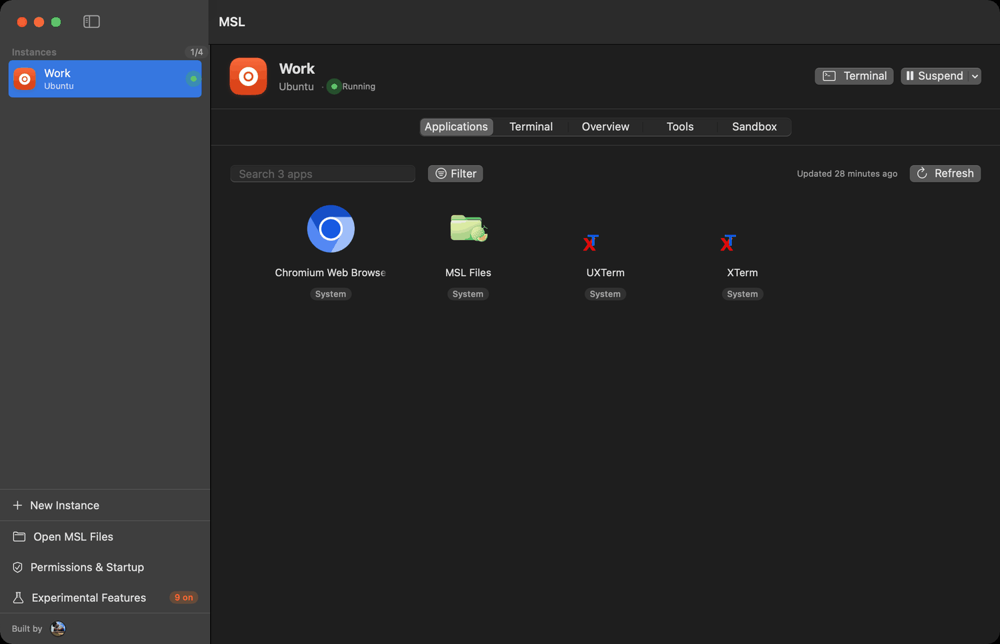 <b>Applications</b> — every app Linux has, read from its own <code>.desktop</code> files. Add one and it becomes a real Mac app.</td>
<td width="50%">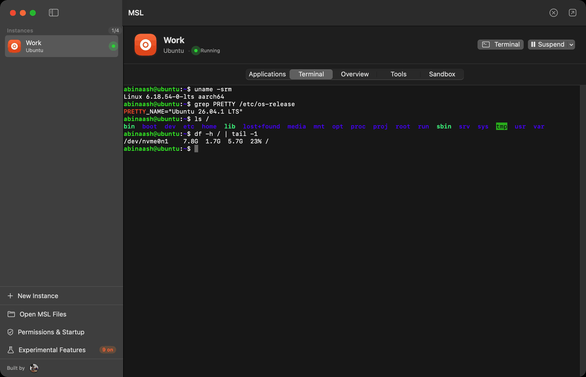 <b>Terminal</b> — a real shell, in the app or in Terminal.app. Same kernel, same userland, no emulation.</td>
</tr>
<tr>
<td width="50%">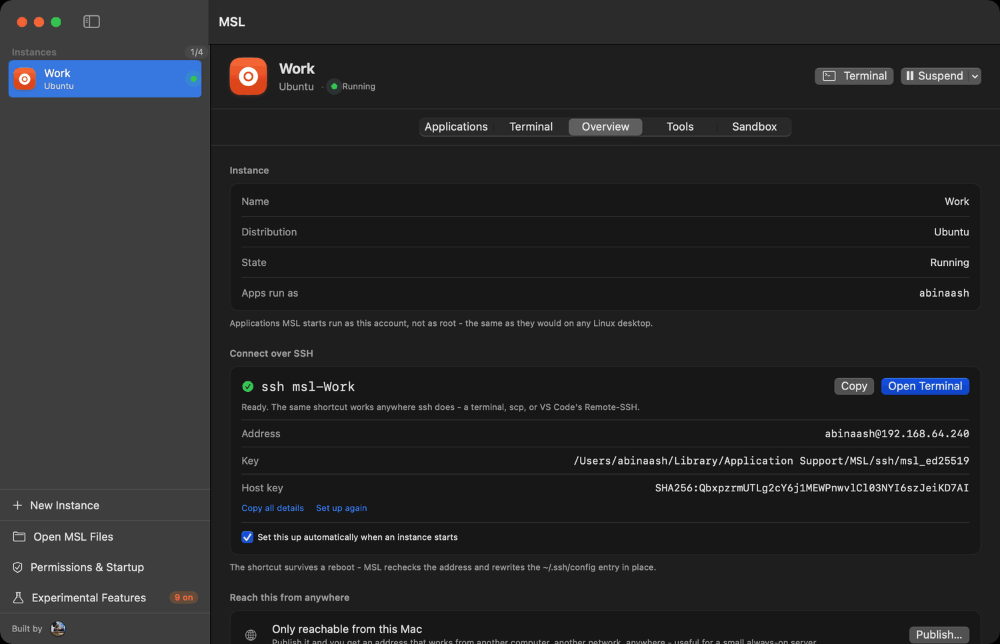 <b>Overview</b> — what this machine is, and <code>ssh msl-Work</code> set up for you, so scp and VS Code's Remote-SSH just work.</td>
<td width="50%">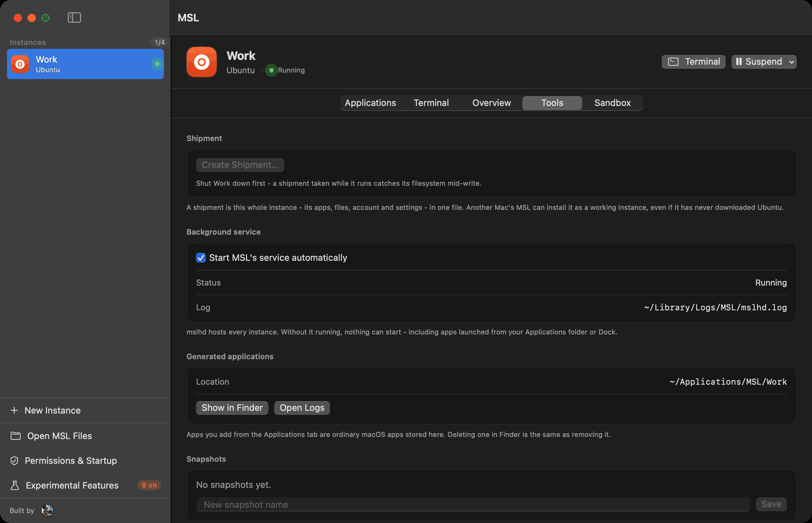 <b>Tools</b> — snapshots, the background service, and shipments: a whole instance in one file, for another Mac.</td>
</tr>
<tr>
<td width="50%">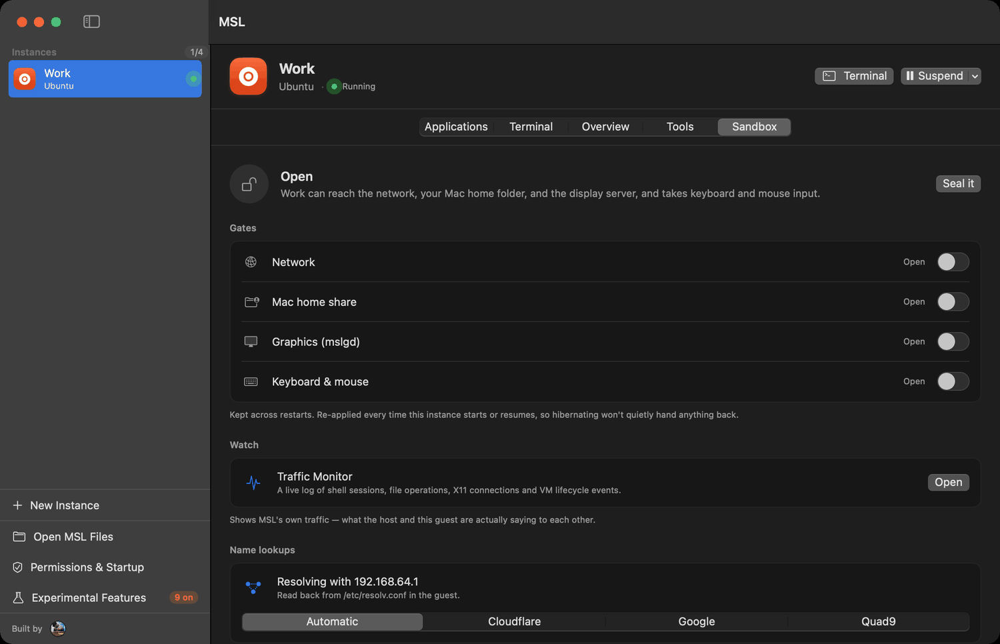 <b>Sandbox</b> — close the network, the Mac home share, the display server or input. Kept across restarts.</td>
<td width="50%">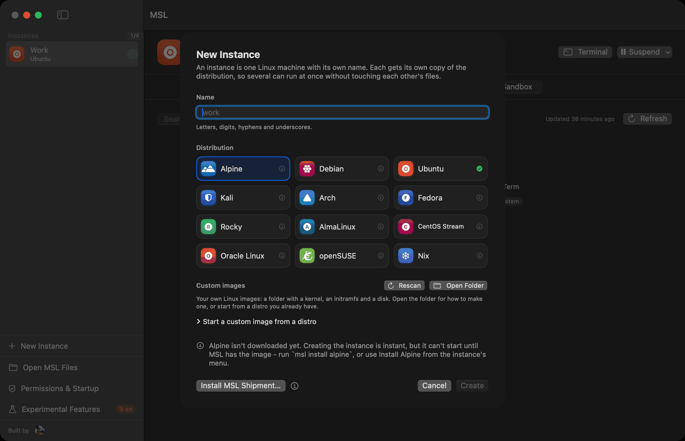 <b>Twelve distributions</b> — each a verified download, kept as a base. Every instance you make from it is a fresh install.</td>
</tr>
</table>

**MSL Files.** The Mac side and the Linux side in one window — and the Open and Save dialog Linux apps get.

<table>
<tr>
<td width="50%">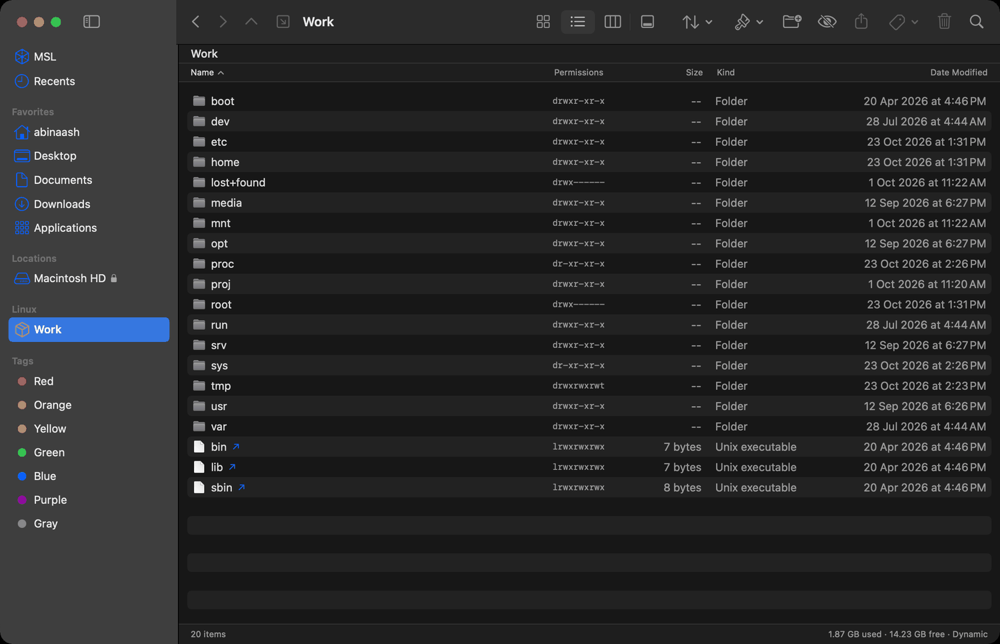 A Linux filesystem with its real permissions, its symlinks and its owners — next to your Mac folders and your Finder tags.</td>
<td width="50%">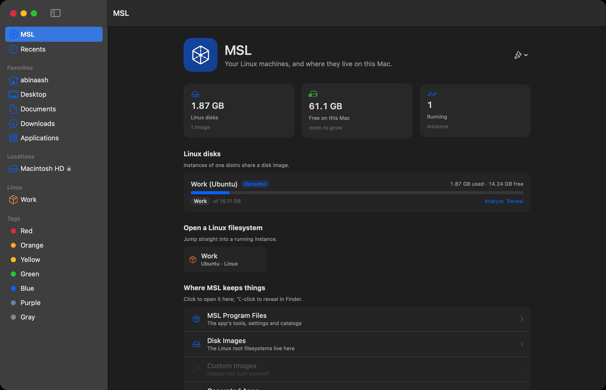 And where it all actually lives on the Mac, with the space each instance is using.</td>
</tr>
</table>

**The rest of it.**

<table>
<tr>
<td width="50%">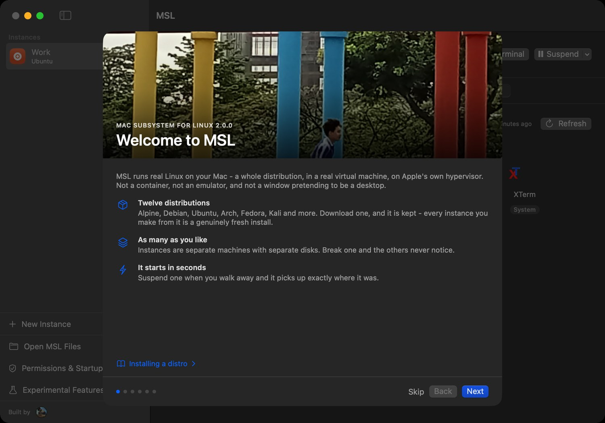 <b>A six-page welcome</b> on first run, then a 121-article guide inside the app.</td>
<td width="50%">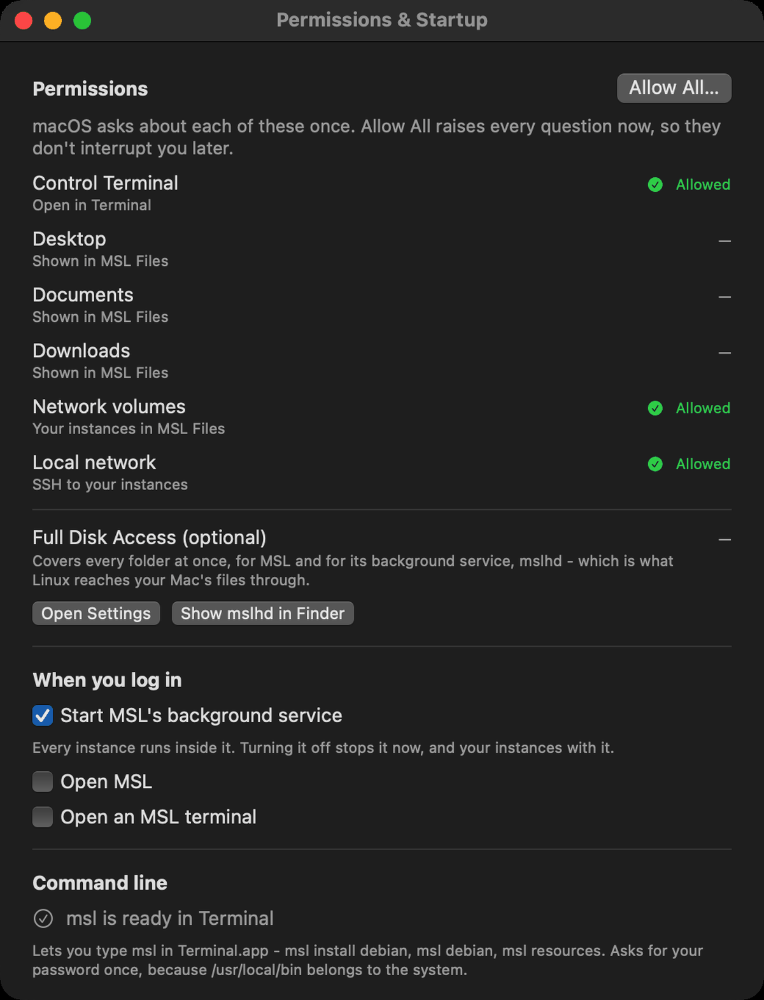 <b>Permissions &amp; Startup</b> — every macOS permission MSL wants, asked for once, with what each one is for.</td>
</tr>
<tr>
<td width="50%">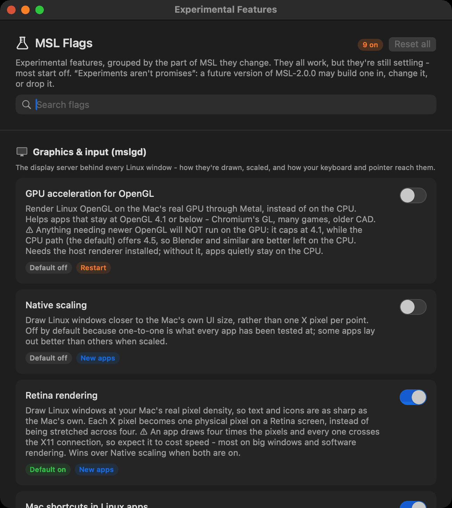 <b>MSL Flags</b> — retina rendering, the Mac menu bar, Mac shortcuts, OpenGL on the real GPU. Experiments aren't promises.</td>
<td width="50%"></td>
</tr>
</table>

## First, a word about the name

MSL isn't really a subsystem — nothing's woven into macOS, there's no kernel extension, no compatibility layer. Underneath, every instance is a lightweight VM, the same foundation a lot of other Mac virtualization apps use (WSL 2 on Windows is one too, for what it's worth).

Also like, because WSL... MSL... Kinda a theme, you feel me... yeah, sorry.

## What it will feel like

Open Terminal and type `msl <instance name>`. A second later you're in a real Linux shell, signed in as your own account, with job control, colours, line editing, and your Mac's home folder waiting at `/mnt/mac`. Type `gimp`, and GIMP opens as a Mac window with its own icon in the Dock and its own name in the menu bar.

Close the lid and MSL freezes your instances before the Mac sleeps; open it again and everything's exactly where you left it. Walk away from an instance and it suspends itself so it stops burning CPU, then wakes the moment you open a shell or an app. Shut the Mac down and your Linux apps get a chance to ask about unsaved work first.

None of that needs a window of its own. MSL has one if you want it, but you rarely have to open it.

## What's inside

<table>
<tr>
<td width="50%" valign="top">

### Linux, the WSL way

- **Twelve download ready distributions**, from Alpine to Nix, each a verified download, plus custom images you build yourself.
- **Named instances**, up to eight of them and four running at once, each with its own settings.
- **A real shell wherever you are**: the app's Terminal tab, Terminal.app, the `msl` command, or SSH, which sets itself up the first time you ask for it.
- **Your own Linux account**, created on first start, with sudo asking for its own password.

</td>
<td width="50%" valign="top">

### Your Mac and Linux, both ways

- **Your Mac home folder inside Linux**, at `/mnt/mac`, from the first boot. ls in your Linux and you'll see Mac sitting in your home dir.
- **Linux's files on your Mac**, by instance name, in [MSL Files](#msl-files).
- **Links from Linux apps open on the Mac**, in your own browser and mail app.
- **"Show in folder" from a Linux app** opens MSL Files instead of a Linux file manager (can be disabled).

</td>
</tr>
<tr>
<td width="50%" valign="top">

### Linux apps, as Mac apps

- **Every GUI app in an instance**, found automatically, with its real icon.
- **Add any of them to your Applications folder**, so Spotlight and Launchpad can open them with MSL closed.
- **Pin them to the Dock.** Opening one starts its instance if it needs to.
- **Drawn by [mslgd](#mslgd)**, MSL's own X11 server, so each window is a genuine Mac window.

</td>
<td width="50%" valign="top">

### Sized to fit, and kept safe

- **CPUs, memory and disk per instance.** Memory can be fixed or dynamic, and disks only take the space they actually use.
- **Suspend, hibernate and snapshots**, with instances frozen safely whenever your Mac sleeps, shuts down or logs out.
- **Disk check and repair from the Mac**, with an automatic backup before anything is touched.
- **A Sandbox** that cuts an instance off from the network, your files, graphics or input, with a live Traffic Monitor.

</td>
</tr>
</table>

## MSL Files

It looks like Finder. It isn't Finder. (◞‸◟)

A running instance does show up in Finder, as a network volume called `127.0.0.1`, with nothing telling you which instance it even is. The easy fix would've been a better volume name. Instead there's a whole file manager, written from scratch in SwiftUI — over 5,000 lines — just to make moving files between macOS and Linux feel like something your Mac does normally.

It has Finder's four views, Finder's sidebar, Finder's keyboard shortcuts, right down to Return renaming instead of opening and ⇧⌘. for hidden files. Quick Look, Get Info, copy and paste, drag and drop, real Finder tags, Recents and tag searches through Spotlight, a Trash that knows Linux volumes don't have one. Your Mac folders sit in the sidebar right above every running instance, so getting a file from Downloads into Linux is one drag.

Literally made because finder workflow go brr. Has git integration and some neat dev workflow stuff >:3

## mslgd

Linux GUI apps draw through a display protocol called X11. On a Mac the usual answer is XQuartz, and XQuartz works - the windows appear. But under XQuartz, every Linux app is a window belonging to XQuartz. One Dock tile for all of them, one icon, a menu bar that says XQuartz no matter which app you're actually in, Mission Control stacking them all together.

I wanted the windows to belong to the apps. As far as I could tell, the only way there is to be the X server. So MSL has its own.

**mslgd** is an X11 server written from scratch in Swift: about 13,700 lines across 30 files, no Xlib, no X.Org code underneath. It speaks the X11 wire protocol directly and draws straight into AppKit and Core Graphics, so every Linux window is a real `NSWindow`. Each Linux app runs in its own small process on the Mac side, because macOS hands out exactly one Dock tile per process — that's what gets every app its own tile, icon, menu bar name, and place in Mission Control and ⌘-Tab. A bit... A lot finicky? Yeah... But it does work?

What it handles as of yet:

- **The core protocol**: windows, pixmaps, graphics contexts, images, properties, selections, and fonts through Core Text.
- **Rendering**: RENDER compositing, glyphs, gradients, trapezoids, transforms and clipping, with SHAPE for windows that aren't rectangles, plus RANDR and BIG-REQUESTS.
- **Input**: XInput 2 including raw motion, trackpad scrolling, middle-click and drags, and XKB keymaps that follow your Mac's keyboard layout and switch when you switch it.
- **Behaving like a Mac app**: the close button asks the app first, so unsaved work gets its "Save changes?", and window icons come from the app itself.
- **Experiments you can switch on**: Linux app menus in the Mac menu bar, ⌘ shortcuts and Mac text navigation inside Linux apps, and a choice of what each Option key means.

GTK 3 and 4 apps run, Qt apps like Krita, GIMP, LibreOffice, galculator and xeyes all run as Mac windows. That's kinda the point. WSLg existed, I kinda wanted to be silly and make smth similar, MSLgd. Yeah.

## Getting started

### What you need

- A Mac with Apple silicon (M1 or later - Neo works too) running **macOS 14 Sonoma** or later.
- A little space: a distro is a download of roughly 60 to 230 MB, and a new instance's 15 GB disk only takes up what Linux actually writes.
- Optionally, **e2fsprogs** from Homebrew, for checking and repairing Linux disks from the Mac. MSL tells you when it wants it.

### Install MSL

1. Download **MSL-2.0.0.pkg** from [Releases](../../releases/latest) and open it.
2. The package isn't notarized yet, so the first time, macOS refuses to open it. That's expected. Click **Done**, then open **System Settings ▸ Privacy & Security**, scroll down to the note saying MSL-2.0.0.pkg was blocked, click **Open Anyway**, and confirm with your password or Touch ID. The installer opens and runs normally from there. (in my defense, I am broke, can't get a dev acc to verify it lol)
4. That's it: **MSL** is in your Applications folder, and the `msl` command is ready in Terminal.

### With the MSL app

1. Open **MSL** and press **⌘New instance** for a new instance. Give it a name and pick a distribution.
2. Click **Install** in the instance's header to download the distro. Every download is checked against its published checksum before it's used.
3. MSL walks you straight to **Storage** to choose how big the disk should be, then to the **Terminal** tab, where Linux asks you to create your account.
4. Open the **Applications** tab to see the Linux apps inside. Open them, add them to your Applications folder, or pin them to the Dock.

### With Terminal

1. Type `msl` on a fresh Mac and it lists every distribution you can download, with its version and size.
2. Run `msl install debian`. MSL downloads Debian, then asks what to call your instance and how many CPUs, how much memory and how much disk it should have.
3. Run `msl debian`, or whatever you named it. The first start asks you to create your Linux account, and from then on it's straight into your shell.
4. `msl files` opens MSL Files, and `msl help` lists every command and opens the full guide in the app.

### Upgrading and uninstalling

Installing a newer package over an older one keeps every instance, image and setting. `msl uninstall` removes MSL and leaves your Linux exactly where it was, so reinstalling picks up right where you left off, and `msl uninstall --everything` removes all of it. The app can do both too, from **Permissions & Startup**.

## Distributions - Images I prepped for MSL, like you can load custom ones still

| Distribution | Release | Download |
|---|---|---|
| Alpine Linux | 3.24 | 59 MB |
| Debian | 13 "trixie" | 102 MB |
| Ubuntu | 26.04 LTS | 111 MB |
| Kali Linux | Rolling | 118 MB |
| Arch Linux ARM | Rolling | 219 MB |
| Fedora | 44 | 121 MB |
| Rocky Linux | 10.2 | 116 MB |
| AlmaLinux | 10.2 | 120 MB |
| CentOS Stream | 10 | 121 MB |
| Oracle Linux | 10.2 | 130 MB |
| openSUSE Leap | 16.0 | 124 MB |
| Nix | on Debian 13 | 203 MB |

Every image ships with MSL's guest services, git, curl, wget, gcc, make, nano, zsh and sudo, and no usable passwords until you create your own account. Arch here is Arch Linux ARM, since Arch itself has no arm64 port, and Nix is the Nix package manager on Debian rather than NixOS. Want something else? The [MSL Image Builder](https://github.com/MilkmanAbi/msl-image-builder) makes custom images from any arm64 container, built to the same standard.

## Where things stand

This is **MSL 2.0.0**.

**Solid:** installing distros and creating instances, shells in every form, CPU, memory and disk sizing, suspend, hibernate and snapshots, protection when the Mac sleeps or shuts down, the shared home folder, MSL Files, the Sandbox, and disk check and repair.

**Experimental:** Linux GUI apps as Mac windows, and everything in **Window ▸ Experimental Features**. Experiments aren't promises. A future version might build one in properly, change it, or retire it, depending on what people actually want.

## Documentation

- **[The MSL Wiki](https://milkmanabi.github.io/MSL-Wiki/)** is the complete guide that ships inside the app, published as a site: from your first instance to repairing a disk and reading a stop code.
- **In the app**, it lives under **Help ▸ MSL Help**, with a search that forgives typos and knows that "RAM" means memory.
- **In Terminal**, `msl help` prints every command.

## The MSL family

| Project | What it is |
|---|---|
| **MSL** | This repository: the app, the `msl` command, the background service and the guest services. |
| [**MSL Image Builder**](https://github.com/MilkmanAbi/msl-image-builder) | A friendly terminal app for building your own Linux images for MSL. |
| [**msl-files on SourceForge**](https://sourceforge.net/projects/msl-files/files/) | Where the distribution images are published. |

## Contributing

Bug reports, ideas and pull requests are all welcome, and so is just telling me what you think in the [community feedback form](https://docs.google.com/forms/d/e/1FAIpQLScJm6KavA6mDJE9ntoH2YPvlsSoEJZaissnvr_b4gG68b3ixA/viewform?usp=dialog). A good bug report says which Mac and macOS version you're on, which distro, what you expected and what happened, and includes what `msl doctor` prints. Logs live in `~/Library/Logs/MSL`.

Everyone who's helped is in [CONTRIBUTORS.md](CONTRIBUTORS.md), and if you're pointing an AI coding agent at the repository (which like, feel free to), [AGENTS.md](AGENTS.md) is written for it.

## Licence

MSL uses two licences, on purpose, because stuff

- **mslgd**, the X11 server, is under the **GNU General Public License v3**, along with anything derived from it. It lives in `Sources/MSLCore/X11`, `Sources/MSLCore/X11InputGate.swift`, `Sources/mslgui` and `Guest/init/x11tunnel.c`. It's the hardest part to build, and it should stay free: use it, change it, ship it, and if you ship changes, share their source.  GPLv3 because took a lotta effort and a lotta testing hours.
- **Everything else** is under the **MIT License**: the app, the `msl` command, the background service, MSL Files, the guest services and all of the virtual machine plumbing. Take it and build whatever you like. MIT because it's a mediocre random generic VM, just code with not that much effort.

MSL.app and the programs built from this repository include mslgd, so those builds, taken as a whole, are distributed under the GPL v3, yeah cumbersome, sowwy. The distribution images MSL downloads keep their own upstream licences - not MSL's, ofc. The full texts are in [LICENSE](LICENSE) and [LICENSE-MIT](LICENSE-MIT) nfor ref.

 

  <picture>
    <source media="(prefers-color-scheme: dark)" srcset="Assets/Abi_Logo-Dark.png">
    
  </picture>
   
  Literally made this because I wanted to move to a macbook from my old Surface Laptop 3 and wanted smth similar to WSL. No other real reason, won't lie. Also because like, I wanna play linux flatpak games on macos, i guess.

  If you like this, please 🌟 it, it makes me feel fuzzy and nice inside. And kinda like a cow. A cow with super APT powers.

